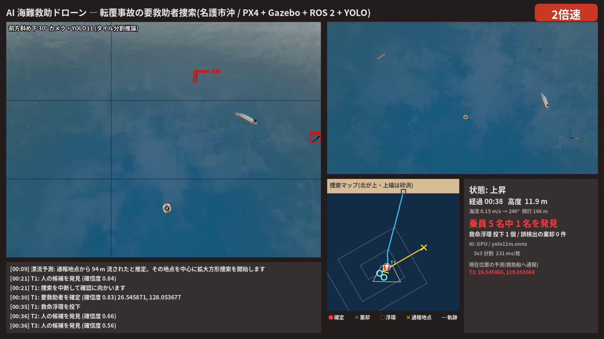
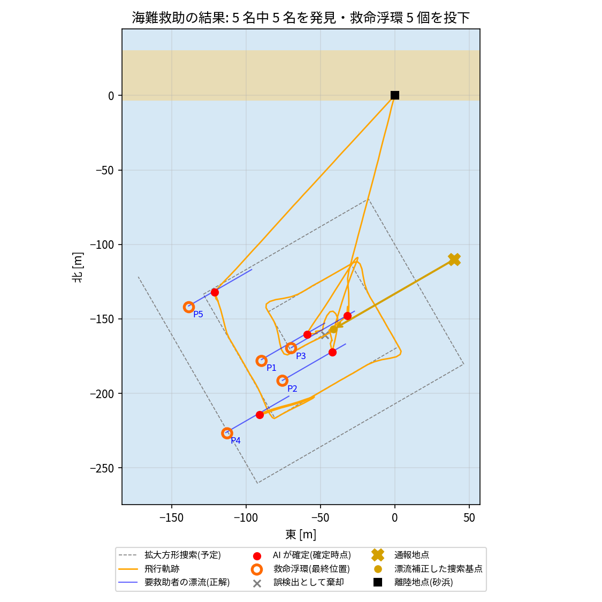
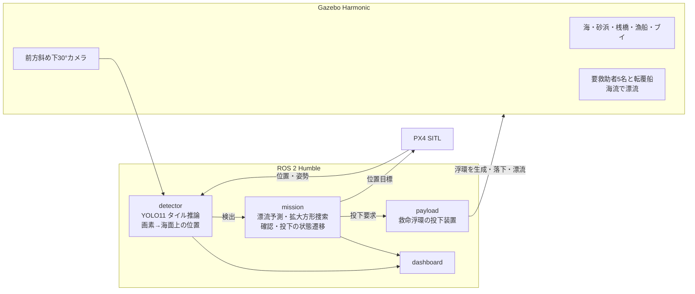

# AI 海難救助ドローン ― 転覆事故の漂流者を AI で見つけ、救命浮環を届ける

Physical AI 応用講座1 最終課題(海難救助版)。

## 想定

名護市のシーグラスビーチ沖で釣り船が転覆し、乗員 5 名が海に投げ出されました。要救助者は海流に流され続けています。通報から 10 分後に、ドローンが砂浜から出動します。

## ドローンの動き

ドローンは次の順に自律で動きます。

1. **漂流予測**: 海流の予報と経過時間から、要救助者がいまどこまで流されたかを推定する。
2. **拡大方形捜索**: 推定した地点を中心に、IAMSAR(国際航空海上捜索救助マニュアル)の拡大方形捜索で海面を探す。
3. **発見と再確認**: カメラ映像から AI(YOLO11)で人の候補を見つけ、近づいて高度を下げ、もう一度 AI で確かめる。
4. **救命浮環の投下**: 流され続ける要救助者の位置を予測し、その真上で救命浮環を投下する。
5. **帰還**: 乗員 5 名を全員見つけたら、捜索を打ち切って砂浜に戻る。

## 使っている技術

- シミュレータ: PX4 SITL + Gazebo Harmonic
- 制御: ROS 2 Humble(オフボード制御)
- AI: YOLO11m(ONNX Runtime、GPU で推論)



## デモ動画

YouTube: (提出時に URL を記載)。本編は 2 倍速です。

## 結果(3 回飛行。3 回目がデモ動画)

| | 1回目 | 2回目 | 3回目 |
|---|---|---|---|
| 発見した要救助者(乗員 5 名) | 5 | 5 | 5 |
| 誤った確定 | 0 | 0 | 0 |
| 誤検出として棄却した候補 | 0 | 1 | 1 |
| 確定位置の誤差 平均 / 最大 [m] | 0.45 / 0.77 | 0.49 / 0.92 | 0.65 / 0.99 |
| 救命浮環と要救助者の距離 平均 / 最大 [m] | 0.51 / 0.87 | 0.45 / 1.07 | 0.65 / 1.19 |
| 全員を発見するまで [s] | 161 | 174 | 189 |
| 飛行時間 [s] | 216 | 229 | 240 |

- 救命浮環は、15 個すべてが要救助者から 1.2 m 以内に落ちた。手を伸ばして届く目安の 2 m 以内に収まっている。
- 漂流補正の効果: 要救助者の集団の中心からの距離は、通報地点では約 107 m ある。漂流補正をした捜索の中心では約 15 m まで縮まる。



## 仕組み



| 状態 | 内容 |
|---|---|
| 捜索基点へ移動 | 通報地点 + 海流 × (通報からの経過時間 + 到着までの時間)を基点にし、そこへ向かう |
| 拡大方形捜索 | 基点から 1S, 1S, 2S, 2S, 3S… と右回りに広げる。S はカメラの撮影幅の 75%(約 32 m)。最初の脚は海流の下流方向 |
| 候補へ移動・降下して確認 | 確信度 0.45 以上の人を候補にする。予測位置が画像の中央に写る位置へ移動し、高度 10 m で再確認する |
| 救命浮環を投下 | 確定したら、予測位置の真上の高度 6 m で 1.5 秒静止して投下。浮環は落下後、海流で一緒に流れる |
| 捜索へ復帰 / 帰還 | 中断した地点に戻る。乗員数(5 名)を全員確定するか、捜索パターンを飛び終えたら砂浜に戻る |

## 工夫した点

1. **漂流予測で捜索の中心を決める**: 通報地点をそのまま探すと、要救助者はすでに約 100 m 流されている。海流の予報と経過時間で捜索の中心をずらすことで、出動してすぐに最初の要救助者を見つけられる(30 秒前後)。
2. **拡大方形捜索**: 海難救助の国際基準である IAMSAR の捜索パターンを使った。推定位置の近くから順に、外側へ広げて探す。脚の間隔は、カメラの撮影幅から計算している。
3. **動く対象の追跡**: 要救助者は海流で流され続ける。そこで各候補を「推定した位置と時刻」として持ち、照合・接近・投下では「経過時間 × 海流」を足した予測位置を使う。確定位置は、近距離での観測を同じ時刻に揃えてから平均する。
4. **救命浮環の投下装置**: 確定した要救助者の真上で、救命浮環を自由落下させる。Gazebo には浮力の計算が無いので、浮環は重力を切ったモデルにし、落下(z = h − g t²/2)と漂流の動きを `payload` ノードが与える。
5. **評価を AI から切り離す**: 要救助者と浮環の本当の位置は、評価用の `truth_logger.py` だけが Gazebo から記録する。AI 側には一切渡さない。評価用のスクリプトが、確定・投下の時刻の本当の位置を補間して照合する。
6. **陸上版から引き継いだ工夫**: 画像のタイル分割推論、カメラを 30° 前へ傾けた捜索用機体、2 段階確認、姿勢を補正した位置推定、GPU / CPU の自動切り替え。

設計の根拠になった実験は [docs/experiments.md](docs/experiments.md) にあります。

説明資料(docs/report.pdf)の各章を、図と表で詳しく解説した資料もあります:[docs/解説資料_レポート編.pdf](docs/解説資料_レポート編.pdf)(元の HTML は [docs/guide.html](docs/guide.html))。

## 動かし方

### 前提

- Ubuntu 22.04、NVIDIA GPU(なくても CPU で動く)
- ROS 2 Humble、Gazebo Harmonic(`ros-humble-ros-gzharmonic`)
- PX4-Autopilot(`~/work/PX4-Autopilot`)、Micro XRCE-DDS Agent
- `px4_msgs` をビルドした ROS 2 ワークスペース(既定は `~/work/map-drone/px4_ws`。`scripts/env.sh` の `PX4_WS` で変更できる)

### 初回のセットアップ

```bash
git clone https://github.com/ba2vwbus13/pai-ai-sea-rescue-drone.git ~/work/pai_sea
cd ~/work/pai_sea
./scripts/setup.sh
```

`setup.sh` は次を行います。

- AI 推論用の仮想環境の作成
- YOLO11 の ONNX への書き出し
- Gazebo のモデルの取得とワールドの生成
- 捜索用機体と PX4 の機体設定(4099)の登録
- ROS 2 パッケージのビルド

### 実行(ターミナルを 3 つ使う)

```bash
./scripts/start_sim.sh     # 1. PX4 + Gazebo サーバー
./scripts/start_view.sh    # 2. Gazebo の 3D 画面(ドローンを追従)
./scripts/start_ai.sh      # 3. AI 海難救助(自動で離陸 → 捜索 → 投下 → 帰還)
```

終わったら、`results/` に報告書(`mission_*.json`)と本当の位置の記録(`truth_*.jsonl`)が保存されます。評価は次のコマンドで行います。

```bash
python3 tests/evaluate_mission.py results/mission_YYYYMMDD_HHMMSS.json
```

### デモ動画の作成

```bash
./scripts/record_demo.sh video/raw.mp4
SPEED=2 ./scripts/make_video.sh video/raw.mp4 results/mission_*.json
```

## ファイル構成

```
ros2_ws/src/ai_patrol/
  ai_patrol/yolo_detector.py    YOLO(ONNX)のタイル分割推論(人・船)
  ai_patrol/geo.py              画素 → 海面上の位置、緯度経度の変換
  ai_patrol/detector_node.py    AI 検出ノード
  ai_patrol/mission_node.py     漂流予測・拡大方形捜索・確認・投下・報告書
  ai_patrol/payload_node.py     救命浮環の投下装置(浮環の生成・落下・漂流)
  ai_patrol/dashboard_node.py   表示画面
  config/params.yaml            通報内容・海流・捜索のパラメータ
worlds/make_world.py          海のワールド(漂流する要救助者)と正解データの生成
gz_models/                    捜索用機体(斜めカメラ)、PX4 の機体設定、Gazebo の画面設定
scripts/                      セットアップ・起動・本当の位置の記録・録画・動画編集
tests/                        海面での検出実験、ミッションの評価
results/                      3 回分の報告書と本当の位置の記録
```

## ライセンス

このリポジトリのコードは MIT ライセンスです。

使用している外部のソフトウェアとモデルは、それぞれのライセンスに従います。

- YOLO11 の重み: Ultralytics、AGPL-3.0。リポジトリには含めず、`setup.sh` で取得します。
- PX4: BSD-3-Clause
- Gazebo: Apache-2.0
- Gazebo Fuel のモデル: 各モデルのライセンス
