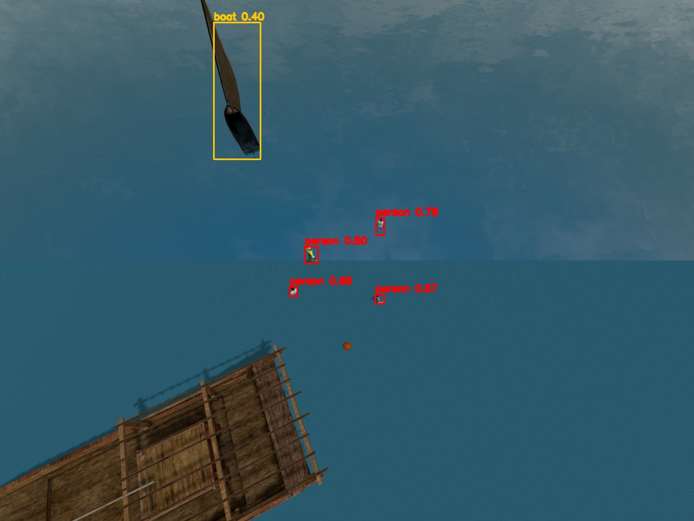

# 実験の記録(海難救助版)

この海難救助版は、陸上版(災害時の要救助者捜索)を土台にしています。陸上版の実験で決めたことは、次の 4 つです。

- 画像のタイル分割推論
- カメラを 30° 前へ傾ける
- 捜索高度 18 m
- YOLO11m を使う

この記録では、海に特有の点を確かめた実験と、ミッション全体の評価をまとめます。

## 実験1: 海面での人の検出

`tests/make_sea_test_world.py` で実験しました。2 種類の海面に次のものを置き、カメラの高度と角度を変えて YOLO11m(3x3 タイル)で検出しました。

| 置いたもの | 内容 |
|---|---|
| 立ち泳ぎの人 | 3 名。胸まで水中 |
| 浮いている人 | 1 名 |
| 船 | 2 隻 |
| ブイ | 1 個 |

| 海面 | カメラ | 検出した人(正解 4) | 人の確信度 | 船(正解 2) |
|---|---|---|---|---|
| 単色の海 | 18 m・30° | 4 | 0.62〜0.83 | 1 |
| 単色の海 | 14 m・30° | 4 | 0.75〜0.87 | 0 |
| 単色の海 | 10 m・35° | 5* | 0.63〜0.87 | 1 |
| 波模様の海(Coast Water) | 18 m・30° | 4 | 0.67〜0.80 | 1 |
| 波模様の海(Coast Water) | 14 m・30° | 4 | 0.58〜0.87 | 0 |
| 波模様の海(Coast Water) | 10 m・35° | 5* | 0.52〜0.87 | 1 |

\* 正解より多い 1 名は、隣の条件に置いた人が画像の端に写り込んだもの。

わかったこと:

- 体の一部しか水面に出ていない人も、斜めのカメラなら確信度 0.5 以上で検出できる。陸上版と同じ高度 18 m・30° をそのまま使える。
- 船の検出は安定しない(大きな船 2 隻のうち 1 隻だけを、確信度 0.40 で検出)。そのため捜索の対象は人に絞り、船は誤検出の要因として置いた。
- 全長 1 m ほどの小さなボートは、船とも人とも検出されなかった。転覆船は、このボートを 4 倍に拡大して裏返して作った。

## 実験2: 漂流の表現の確かめ

最初は、静止モデルの位置を Gazebo のサービス(`set_pose`)で動かそうとしました。しかし、カメラの映像では、元の位置にも像が残りました。

そこで、要救助者は「重力なし・当たり判定なし」の動くモデルにしました。そのうえで、Gazebo の `VelocityControl` で海流の速度を与えています。

本当の位置の記録から測った漂流の速さは、0.150 m/s でした(335 秒で 50.2 m)。設定値どおりで、シミュレーションの時間と現実の時間のずれもありません。

## 実験3: 海難救助ミッション全体

| 項目 | 内容 |
|---|---|
| 想定 | 通報された転覆地点は、離陸地点の南 110 m・東 40 m。出動は通報の 10 分後 |
| 要救助者 | 5 名(浮いている人 2・立ち泳ぎの人 3)と転覆船 |
| 海流 | 0.15 m/s で方位 240° へ流れる |
| 評価 | `tests/evaluate_mission.py` で、確定・投下の時刻の本当の位置(`truth_*.jsonl`)と照合 |

| | 1回目 | 2回目 | 3回目 |
|---|---|---|---|
| 発見(再現率) | 5/5 | 5/5 | 5/5 |
| 誤った確定 | 0 | 0 | 0 |
| 誤検出として棄却 | 0 | 1 | 1 |
| 確定位置の誤差 平均 / 最大 | 0.45 / 0.77 m | 0.49 / 0.92 m | 0.65 / 0.99 m |
| 救命浮環と要救助者の距離 平均 / 最大 | 0.51 / 0.87 m | 0.45 / 1.07 m | 0.65 / 1.19 m |
| 最初の 1 名を確定 | 31 s | 31 s | 31 s |
| 全員を確定 | 161 s | 174 s | 189 s |
| 飛行時間 / 距離 | 216 s / 1021 m | 229 s / 1024 m | 240 s / 1094 m |

漂流補正の効果は、捜索を始めた時点の要救助者 5 名の重心までの距離で比べました。

| 捜索の中心 | 重心までの距離 |
|---|---|
| 通報地点をそのまま使う | 約 107 m |
| 漂流予測で補正した基点 | 約 15 m |

カメラが一度に写す範囲は前方 50 m ほどです。補正しなければ、まず通報地点のまわりを空振りで探すことになります。

わかったこと:

- 3 回とも全員を発見し、誤った確定はなかった。誤検出の候補(ブイや浮遊物)は、降下して再確認した段階で棄却できた。
- 救命浮環は 15 個すべてが要救助者から 1.2 m 以内に落ちた。要救助者が動いていても、「推定時刻からの経過時間 × 海流」で予測した位置に投下すれば十分に届く。
- 遅く見つかった人(P4・P5)ほど、位置の誤差がやや大きかった(最大 0.99 m)。海流は設定どおりに流れていることを確認済みなので、漂流予測のずれではない。斜めの遠い位置から初めて見つけた人ほど、近距離観測の回数が少ないことなどが考えられる。原因の切り分けは今後の課題。
